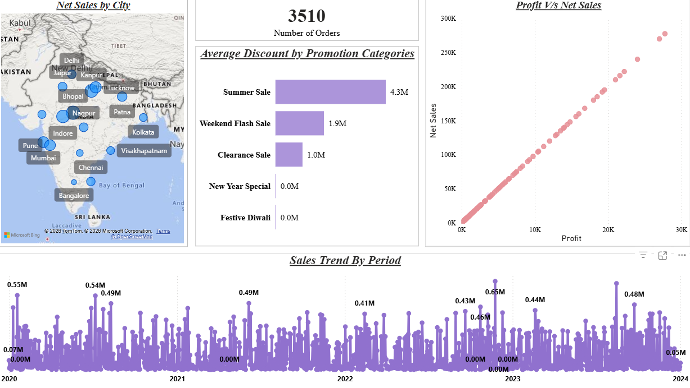
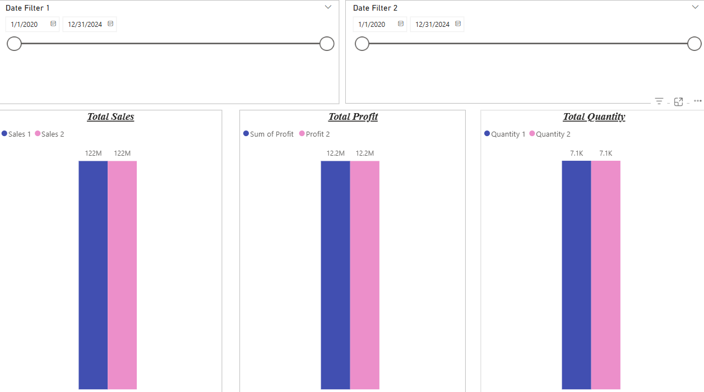
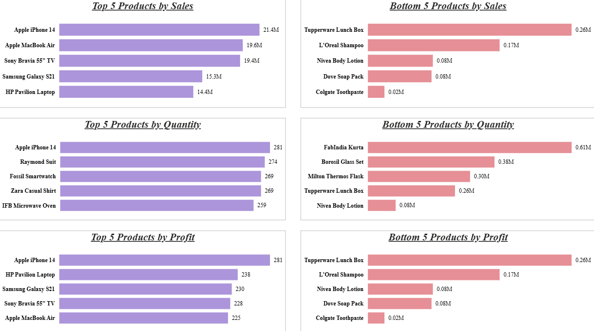

# 📊 Sales Data Analysis using Power BI

An interactive sales analysis dashboard built using Microsoft Power BI as a hands-on practice project while learning through Krish Naik's Data Analyst course.

## 📌 Table of Contents

- Project Overview
- Dashboard Preview
- Business Questions
- Dashboard Features
- Tools Used
- Key Learning Outcomes
- Repository Structure
- How to View the Project
- Learning Source and Credit

## 🎯 Project Overview

This project focuses on analyzing sales performance through an interactive Power BI dashboard. It explores sales, profit, quantity, city-wise sales, promotional discounts, product performance, and sales trends over time.

The dashboard presents business data through visualizations, comparisons, and date filters to make sales performance easier to understand.

## 🖼️ Dashboard Preview

### 1. Sales Dashboard Overview

This dashboard page includes:
- Net Sales by City
- Number of Orders
- Average Discount by Promotion Categories
- Profit vs Net Sales
- Sales Trend by Period



### 2. Top 5 and Bottom 5 Products Analysis

This page compares products across three metrics:
- Sales
- Quantity
- Profit

It displays the top 5 and bottom 5 products for each metric.



### 3. Date Filter and Comparison Analysis

This page includes date range filters and comparisons for:
- Total Sales
- Total Profit
- Total Quantity

Users can explore the displayed metrics for a selected date range.


## 🔍 Business Questions

This dashboard helps explore the following questions:

1. Which cities show net sales activity?
2. How do sales change over time?
3. How do profit and net sales relate?
4. Which promotion categories have the highest average discount?
5. Which products rank highest and lowest by sales?
6. Which products rank highest and lowest by quantity?
7. Which products rank highest and lowest by profit?
8. How do sales, profit, and quantity compare across date ranges?

## 📈 Dashboard Features

| Feature | Description |
|---|---|
| City-wise Sales | Visualizes net sales by city |
| Order Analysis | Displays the number of orders |
| Promotion Analysis | Compares average discounts by promotion category |
| Profit vs Sales | Visualizes the relationship between profit and net sales |
| Sales Trend | Shows sales trends across periods |
| Product Performance | Compares top and bottom products by sales, quantity, and profit |
| Date Filters | Supports date-range-based comparisons |

## 🛠️ Tools Used

- **Microsoft Power BI** — dashboard creation, data visualization, report filters, and presentation.

## 💡 Key Learning Outcomes

- Practiced creating a multi-page Power BI dashboard.
- Learned to present sales, profit, and quantity metrics visually.
- Practiced comparing top- and bottom-performing products.
- Explored city-wise sales and sales trends.
- Gained hands-on practice with report layout, filters, and data visualization.

## 📂 Repository Structure

```text
Sales-Data-Analysis-PowerBI/
│
├── README.md
├── Sales_Data_Analysis.pbix
│
└── screenshots/
    ├── sales_dashboard_overview.png
    ├── top_bottom_products.png
    └── date_filter_analysis.png
```

## ▶️ How to View the Project

1. Clone or download this repository.
2. Install Microsoft Power BI Desktop.
3. Open `Sales_Data_Analysis.pbix`.
4. Explore the report pages, visualizations, and available filters.

**Note:** GitHub displays the README and screenshots, but it does not render an interactive Power BI `.pbix` report directly in the browser.

## 🎓 Learning Source and Credit

This is a hands-on practice project completed while learning through **Krish Naik's Data Analyst course**.

The purpose of this repository is to document my learning and practical experience with Power BI. Credit for the original course material belongs to its respective creator.

## ⚠️ Disclaimer

This project is intended for educational and portfolio purposes. Before making the repository public, ensure that the course terms and dataset license permit sharing the Power BI report and its underlying data.

